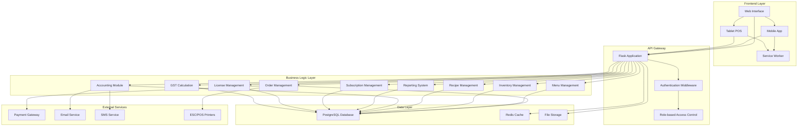
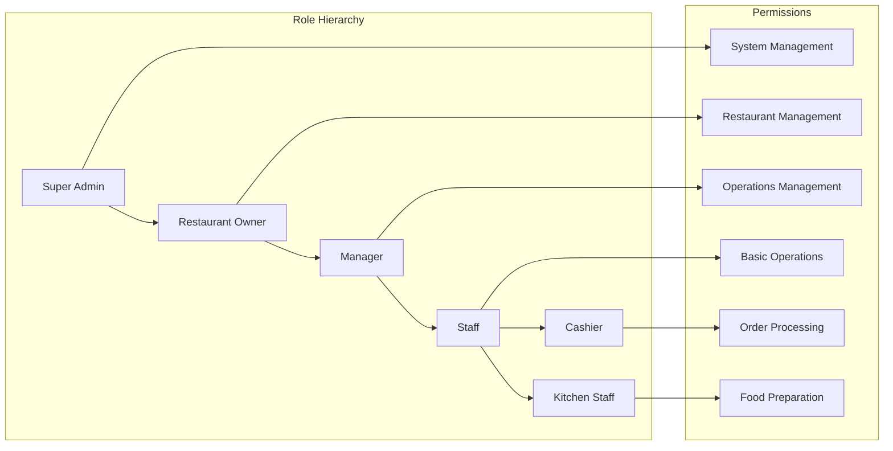
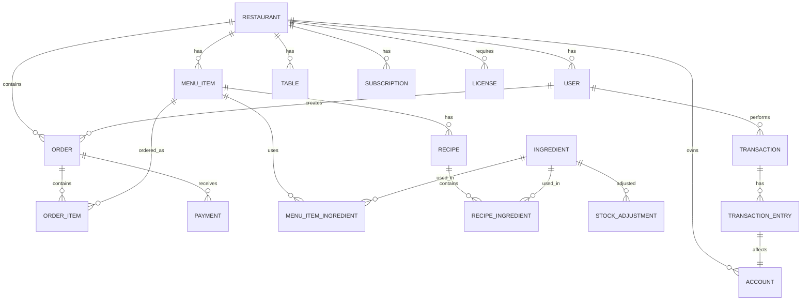
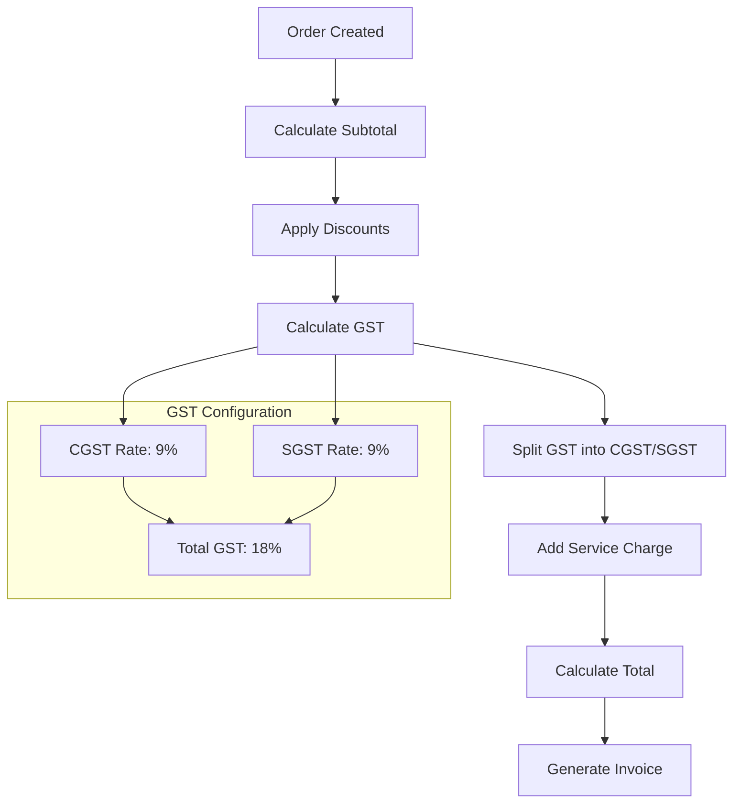
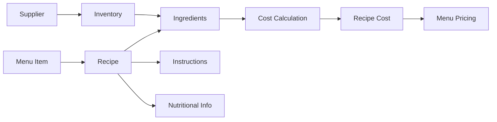
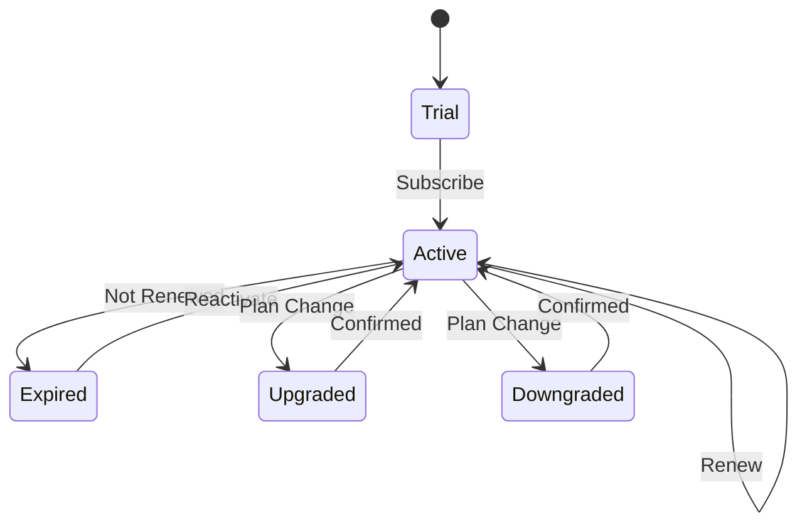
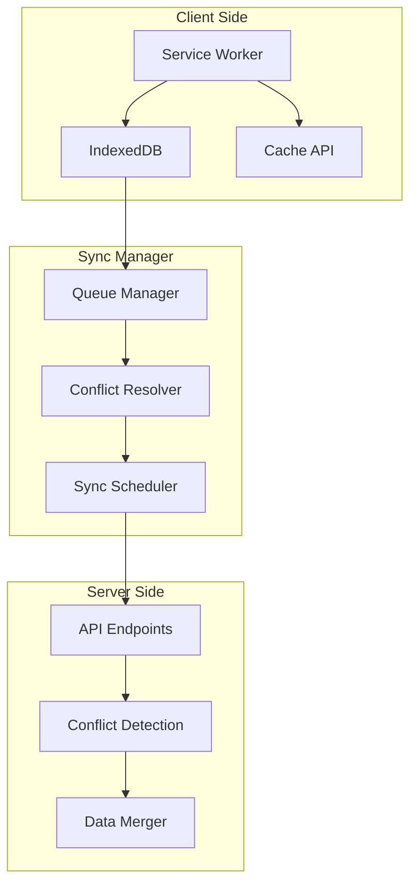
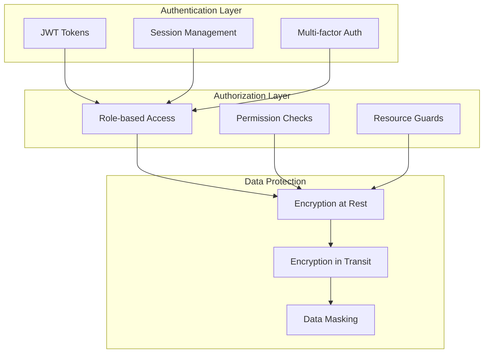
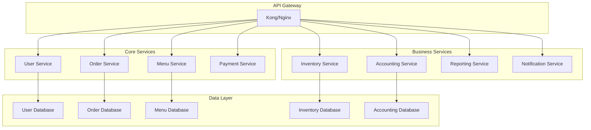
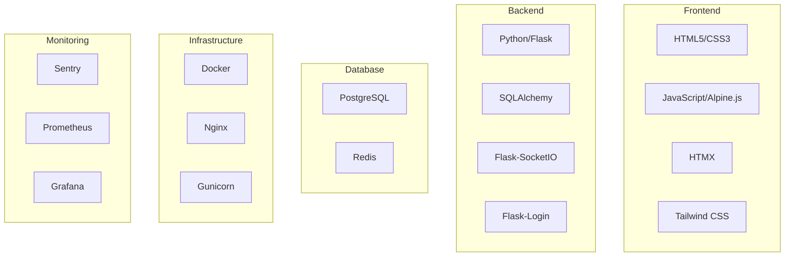

# Restaurant POS System - Architecture Diagram

## System Architecture Overview



## Enhanced User Role System



## Database Schema Relationships



## GST Calculation Flow



## Recipe Management System



## Subscription Management Flow



## Offline Architecture



## Security Architecture



## Microservices Architecture (Future Enhancement)



## Technology Stack



## Deployment Architecture

```mermaid
graph TB
    subgraph "Load Balancer"
        A[Nginx/HAProxy]
    end
    
    subgraph "Application Servers"
        B[App Server 1]
        C[App Server 2]
        D[App Server 3]
    end
    
    subgraph "Database Cluster"
        E[Primary DB]
        F[Replica DB 1]
        G[Replica DB 2]
    end
    
    subgraph "Cache Layer"
        H[Redis Cluster]
    end
    
    subgraph "File Storage"
        I[MinIO/S3]
    end
    
    A --> B
    A --> C
    A --> D
    B --> E
    C --> E
    D --> E
    E --> F
    E --> G
    B --> H
    C --> H
    D --> H
    B --> I
    C --> I
    D --> I