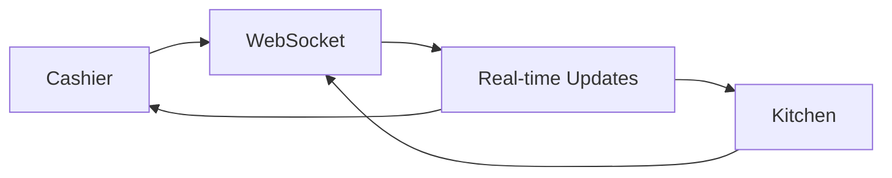

# Restaurant POS System - Implementation Plan

## Overview

This is a comprehensive Restaurant Point-of-Sale (POS) system built with modern web technologies designed for efficiency, reliability, and ease of use in restaurant environments.

## Technology Stack

- **Backend**: Flask (Python), SQLAlchemy, Flask-SocketIO
- **Frontend**: HTML5, HTMX, Alpine.js, Tailwind CSS
- **Database**: SQLite (development) → PostgreSQL (production)
- **Real-time**: WebSocket via Socket.IO
- **Printing**: ESC/POS thermal printer support

## Key Features

### 🎯 Core Functionality
- **Enhanced Multi-role System**: Super Admin, Restaurant Owner, Staff, Cashier, Kitchen, Manager interfaces
- **Real-time Updates**: Live order status between kitchen and front-of-house
- **Menu Management**: Categories, items, variants, add-ons with image support
- **Order Processing**: Cart management, split payments, discounts, tips
- **Table Management**: Visual floor plan, status tracking, order assignment
- **GST Calculation**: Automatic GST calculation with configurable rates
- **Advanced Billing**: Comprehensive billing with tax breakdowns and invoices

### 🚀 Advanced Features
- **Kitchen Display System**: Real-time order tracking with timers
- **Enhanced Reporting & Analytics**: Sales, item performance, staff metrics, financial reports
- **Receipt Printing**: Thermal printer integration with ESC/POS
- **Offline Capability**: PWA with service worker for reliability
- **Responsive Design**: Optimized for tablets, desktops, and mobile
- **Restaurant Recipe Management**: Complete recipe costing and ingredient tracking
- **Accounting System**: Comprehensive accounting with expense tracking and financial reports
- **Subscription Management**: Multi-tier subscription plans managed by Super Admin
- **License Management**: Restaurant licensing and compliance tracking

### 🏢 Enterprise Features
- **Multi-restaurant Support**: Manage multiple restaurant locations
- **Centralized Administration**: Super admin controls for system-wide settings
- **Restaurant Owner Dashboard**: Individual restaurant management and analytics
- **Staff Management**: Employee scheduling, permissions, and performance tracking
- **Inventory Integration**: Recipe-based inventory management with automatic deductions
- **Financial Management**: P&L statements, balance sheets, cash flow reports
- **Compliance Tracking**: GST compliance, tax reporting, and audit trails

## Project Structure

```
pos/
├── app/
│   ├── __init__.py              # Flask app factory
│   ├── models/                   # Database models
│   │   ├── user.py              # User and role models
│   │   ├── menu.py              # Menu items and categories
│   │   ├── order.py             # Orders and payments
│   │   ├── table.py             # Table management
│   │   ├── inventory.py         # Inventory and ingredients
│   │   ├── recipe.py            # Recipe management
│   │   ├── accounting.py        # Accounting and financials
│   │   ├── subscription.py      # Subscription management
│   │   └── license.py           # License management
│   ├── auth/                     # Authentication routes
│   ├── menu/                     # Menu management routes
│   ├── orders/                   # Order processing routes
│   ├── kitchen/                  # Kitchen display system
│   ├── tables/                   # Table management
│   ├── reports/                  # Reporting and analytics
│   ├── accounting/               # Accounting module
│   ├── recipes/                  # Recipe management
│   ├── subscriptions/            # Subscription management
│   ├── licenses/                 # License management
│   ├── billing/                  # Enhanced billing system
│   ├── admin/                    # Super admin functions
│   ├── static/                   # Static assets
│   └── templates/                # Jinja2 templates
├── migrations/                   # Database migrations
├── config.py                     # Configuration settings
├── run.py                       # Application entry point
└── requirements.txt              # Python dependencies
```

## Implementation Phases

### Phase 1: Foundation (Week 1-2)
- ✅ Project setup and basic Flask structure
- ✅ Database models and authentication system
- ✅ Basic UI framework with Tailwind CSS

### Phase 2: Core POS (Week 3-4)
- ✅ Menu management system
- ✅ Cart and order management
- ✅ Cashier interface development

### Phase 3: Advanced Features (Week 5-6)
- ✅ Kitchen Display System with real-time updates
- ✅ Payment processing and checkout
- ✅ Table management system
- ✅ Inventory management

### Phase 4: Enterprise Features (Week 7-8)
- 🔄 Enhanced user role system (Super Admin, Restaurant Owner, Staff)
- 🔄 GST calculation and tax management
- 🔄 Accounting module implementation
- 🔄 Recipe management system

### Phase 5: Business Management (Week 9-10)
- ⏳ Subscription management system
- ⏳ License management
- ⏳ Enhanced reporting and analytics
- ⏳ Multi-restaurant support

### Phase 6: Polish & Offline (Week 11-12)
- ⏳ Enhanced offline capabilities
- ⏳ UI/UX improvements
- ⏳ Performance optimization
- ⏳ Testing and documentation

## Architecture Highlights

### Modern Frontend Approach
- **HTMX**: Handles AJAX requests and DOM updates without complex JavaScript
- **Alpine.js**: Provides reactive components for dynamic UI elements
- **Tailwind CSS**: Utility-first CSS for rapid, responsive design
- **Progressive Enhancement**: Works without JavaScript, enhanced with it

### Real-time Communication


### Database Design
- **Normalized Schema**: Efficient data relationships
- **Role-based Access**: Secure permission system
- **Audit Trail**: Complete order and user activity logging
- **Scalable Design**: Ready for high-volume operations

## Key Implementation Patterns

### HTMX Integration
```html
<!-- Add item to cart -->
<button hx-post="/cart/add" 
        hx-vals='{"item_id": "{{ item.id }}"}'
        hx-target="#cart-container"
        class="bg-blue-600 text-white px-4 py-2 rounded">
    Add to Cart
</button>
```

### Alpine.js Reactive Components
```html
<div x-data="cartManager()">
    <span x-text="cart.total"></span>
    <button @click="addToCart(item)">Add</button>
</div>
```

### Real-time Updates
```python
@socketio.on('update_order_status')
def update_order_status(data):
    # Update database
    order.status = data['status']
    db.session.commit()
    
    # Broadcast to all clients
    emit('order_updated', order_data, broadcast=True)
```

## Development Setup

### Prerequisites
- Python 3.9+
- Node.js 16+ (for frontend tools)
- Modern web browser

### Quick Start
```bash
# Clone and setup
git clone <repository>
cd pos
python -m venv venv
source venv/bin/activate  # Windows: venv\Scripts\activate

# Install dependencies
pip install -r requirements.txt

# Setup database
flask db init
flask db migrate -m "Initial migration"
flask db upgrade

# Run development server
python run.py
```

## User Roles & Permissions

### Super Admin
- Manage all restaurants in the system
- Create and manage subscription plans
- Handle licensing and compliance
- System-wide configuration and settings
- Global reporting and analytics
- User management across all restaurants

### Restaurant Owner
- Manage single or multiple restaurant locations
- Access comprehensive financial reports
- Manage staff and permissions
- Configure restaurant-specific settings
- View business analytics and insights
- Handle subscription and licensing

### Manager
- Access all cashier functions
- Manage menu items and pricing
- View reports and analytics for their restaurant
- Manage staff schedules and performance
- Handle inventory and recipe management
- Configure restaurant operations

### Staff (Waiter/Cashier)
- Take orders and manage cart
- Process payments with GST calculation
- Print receipts and invoices
- View order history
- Manage table assignments
- Basic inventory updates

### Kitchen Staff
- View real-time orders with recipe details
- Update order status
- Print kitchen tickets with ingredient lists
- Manage food preparation workflow
- Update inventory consumption
- Filter orders by preparation station

## Security Features

- **Session-based Authentication**: Secure user sessions
- **Role-based Access Control**: Proper permission enforcement
- **Input Validation**: Comprehensive form validation
- **SQL Injection Protection**: SQLAlchemy ORM protection
- **XSS Prevention**: Proper output escaping
- **CSRF Protection**: Flask-WTF CSRF tokens

## Performance Optimizations

- **Database Indexing**: Optimized query performance
- **Efficient DOM Updates**: HTMX targeted updates
- **Minimal JavaScript**: Alpine.js lightweight reactivity
- **Caching Strategy**: Menu and report caching
- **Lazy Loading**: On-demand data loading

## Mobile & Tablet Support

- **Responsive Design**: Tailwind responsive utilities
- **Touch-friendly UI**: Large touch targets
- **Progressive Web App**: Offline capability
- **Fast Loading**: Optimized for mobile networks

## Integration Capabilities

### Printing
- **ESC/POS Support**: Direct thermal printer integration
- **Receipt Templates**: Customizable receipt layouts
- **Kitchen Tickets**: Automatic ticket printing
- **Cash Drawer**: Integration via printer commands

### Payment Processing
- **Multiple Methods**: Cash, card, UPI, wallet
- **Split Payments**: Multiple payment methods per order
- **Tip Calculation**: Automatic tip suggestions
- **Receipt Options**: Print, email, or SMS

## Testing Strategy

- **Unit Tests**: Model validation and business logic
- **Integration Tests**: API endpoints and database operations
- **End-to-End Tests**: Complete user workflows
- **Performance Tests**: Load testing for concurrent users

## Deployment Options

### Development
- SQLite database
- Flask development server
- Local file storage

### Production
- PostgreSQL database
- Gunicorn WSGI server
- Nginx reverse proxy
- Redis caching
- Docker containerization

## Monitoring & Maintenance

- **Application Logging**: Structured logging with levels
- **Error Tracking**: Exception monitoring
- **Performance Metrics**: Response time tracking
- **User Activity**: Audit trail for compliance

## New Feature Modules

### 🧾 GST Calculation System
- **Configurable Tax Rates**: Support for multiple GST rates (5%, 12%, 18%, 28%)
- **Automatic Tax Calculation**: Real-time GST calculation on orders
- **Tax Breakdown**: Detailed CGST/SGST split on receipts and invoices
- **Tax Reporting**: Comprehensive GST reports for filing
- **HSN/SAC Codes**: Product categorization for tax compliance
- **Input Tax Credit**: Track and manage input tax credits

### 💰 Accounting Module
- **Chart of Accounts**: Complete accounting structure
- **Expense Management**: Track operational expenses
- **Revenue Tracking**: Detailed income streams analysis
- **Financial Reports**: P&L, Balance Sheet, Cash Flow statements
- **Bank Reconciliation**: Match transactions with bank statements
- **Audit Trail**: Complete transaction history and logs
- **Multi-currency Support**: Handle different currencies

### 📊 Enhanced Reporting System
- **Sales Analytics**: Detailed sales reports with trends
- **Menu Performance**: Best-selling items and profitability
- **Staff Performance**: Employee productivity and sales metrics
- **Customer Analytics**: Order patterns and preferences
- **Inventory Reports**: Stock usage and wastage analysis
- **Financial Dashboard**: Real-time financial KPIs
- **Custom Reports**: Build and save custom report templates

### 👨‍🍳 Recipe Management
- **Recipe Creation**: Detailed recipes with ingredients and steps
- **Recipe Costing**: Calculate cost per dish with margins
- **Ingredient Mapping**: Link recipes to inventory items
- **Nutritional Information**: Track calories and nutritional data
- **Recipe Scaling**: Adjust quantities for batch cooking
- **Allergen Tracking**: Manage allergen information
- **Menu Engineering**: Analyze recipe profitability

### 💳 Enhanced Billing System
- **GST Invoices**: Tax-compliant invoicing
- **Multiple Payment Methods**: Cash, card, UPI, wallet, split payments
- **Tip Management**: Automatic tip calculation and distribution
- **Discount Management**: Promotional discounts and loyalty programs
- **Credit Management**: Handle customer accounts and credit limits
- **Recurring Billing**: Subscription-based billing
- **Invoice Customization**: Branded invoice templates

### 📋 Subscription Management
- **Tiered Plans**: Basic, Professional, Enterprise plans
- **Feature-based Pricing**: Different features per plan
- **Usage Tracking**: Monitor feature usage per restaurant
- **Automated Billing**: Monthly/annual subscription billing
- **Plan Upgrades/Downgrades**: Seamless plan changes
- **Trial Management**: Free trial periods and conversions
- **Discount Codes**: Promotional subscription discounts

### 📜 License Management
- **Restaurant Licenses**: FSSAI, Liquor, Health permits tracking
- **License Renewals**: Automated renewal reminders
- **Compliance Monitoring**: Ensure all licenses are current
- **Document Management**: Store license documents securely
- **Multi-location Support**: Manage licenses for multiple branches
- **Audit Readiness**: Quick access to compliance documents
- **Regulatory Updates**: Stay updated with regulation changes

### 🏢 Multi-restaurant Support
- **Centralized Management**: Manage multiple locations from one account
- **Location-specific Settings**: Different menus and pricing per location
- **Cross-location Reporting**: Consolidated reports across all locations
- **Staff Mobility**: Staff can work across multiple locations
- **Inventory Transfer**: Move stock between locations
- **Regional Compliance**: Handle different regional requirements

### 📱 Enhanced Offline Capabilities
- **Offline Order Processing**: Continue taking orders without internet
- **Local Data Storage**: Cache critical data for offline access
- **Sync on Reconnect**: Automatically sync data when internet returns
- **Offline Reports**: Generate basic reports offline
- **Receipt Printing**: Print receipts without internet connection
- **Inventory Updates**: Update inventory levels offline

## Future Enhancements

- **Customer Management**: Loyalty programs and order history
- **Online Ordering**: Web and mobile app integration
- **Delivery Management**: Driver tracking and routing
- **Advanced Analytics**: AI-powered insights and predictions
- **Supplier Management**: Vendor relationships and procurement
- **Payroll Integration**: Staff salary and attendance management
- **API Ecosystem**: Third-party integrations and plugins

## Documentation

- [Architecture Overview](architecture.md) - System design and patterns
- [Implementation Guide](implementation_guide.md) - Technical implementation details
- [Development Roadmap](development_roadmap.md) - Project timeline and milestones
- [Feature Specifications](features.md) - Complete feature list and requirements

## Getting Started

This implementation plan provides everything needed to build a modern, efficient Restaurant POS system. The phased approach ensures that core functionality is delivered first, with advanced features added incrementally.

**Next Steps:**
1. Review the architecture and implementation guide
2. Set up the development environment
3. Begin with Phase 1 implementation
4. Follow the development roadmap for systematic progress

The system is designed to be scalable, maintainable, and user-friendly, providing restaurant staff with the tools they need to serve customers efficiently while giving managers the insights they need to run their business effectively.