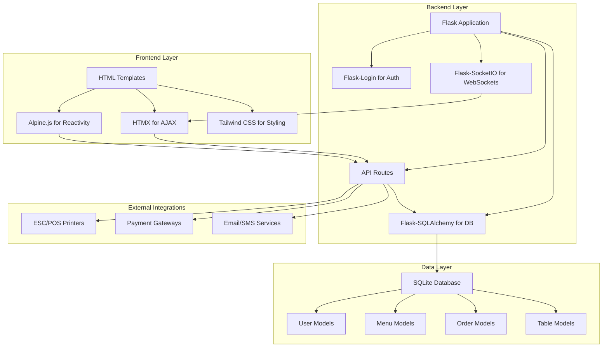
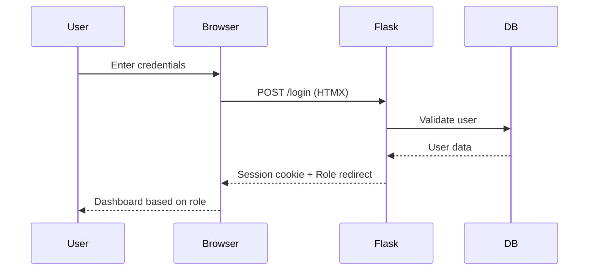
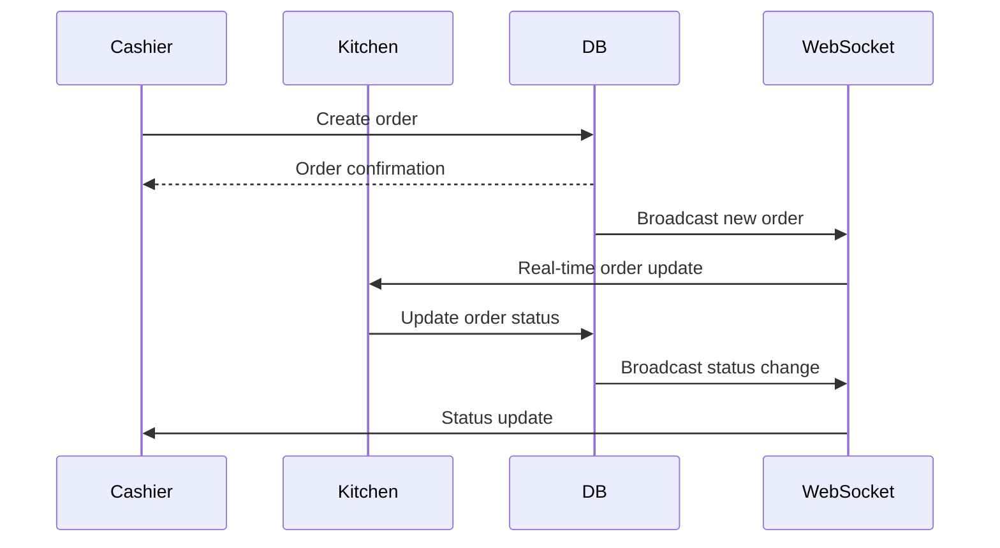
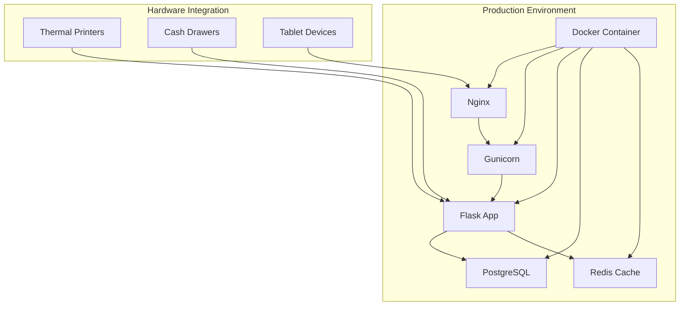

# Restaurant POS System - Architecture & Implementation Plan

## System Architecture Overview



## Project Structure

```
pos/
├── app/
│   ├── __init__.py
│   ├── models/
│   │   ├── __init__.py
│   │   ├── user.py
│   │   ├── menu.py
│   │   ├── order.py
│   │   └── table.py
│   ├── auth/
│   │   ├── __init__.py
│   │   ├── routes.py
│   │   └── forms.py
│   ├── menu/
│   │   ├── __init__.py
│   │   ├── routes.py
│   │   └── forms.py
│   ├── orders/
│   │   ├── __init__.py
│   │   ├── routes.py
│   │   └── forms.py
│   ├── kitchen/
│   │   ├── __init__.py
│   │   ├── routes.py
│   │   └── socketio_events.py
│   ├── tables/
│   │   ├── __init__.py
│   │   ├── routes.py
│   │   └── forms.py
│   ├── reports/
│   │   ├── __init__.py
│   │   ├── routes.py
│   │   └── utils.py
│   ├── static/
│   │   ├── css/
│   │   ├── js/
│   │   └── images/
│   └── templates/
│       ├── base.html
│       ├── auth/
│       ├── menu/
│       ├── orders/
│       ├── kitchen/
│       ├── tables/
│       └── reports/
├── migrations/
├── config.py
├── requirements.txt
├── run.py
└── README.md
```

## Database Schema Design

### User Management
- **Users**: id, email, password_hash, name, role, is_active, created_at
- **Roles**: id, name, permissions (cashier, kitchen, manager, admin)

### Menu Management
- **Categories**: id, name, display_order, is_active
- **MenuItems**: id, name, description, price, category_id, image_url, is_available
- **ItemVariants**: id, item_id, name, price_modifier
- **AddOns**: id, name, price
- **ItemAddOns**: item_id, addon_id

### Order Management
- **Orders**: id, table_id, user_id, status, subtotal, tax, discount, total, created_at
- **OrderItems**: id, order_id, item_id, quantity, price, variant_id, notes
- **OrderItemAddOns**: order_item_id, addon_id
- **Payments**: id, order_id, amount, method, transaction_id, created_at

### Table Management
- **Tables**: id, number, capacity, status, floor_position_x, floor_position_y
- **TableSessions**: id, table_id, order_id, start_time, end_time

## Technology Stack Implementation Details

### Backend (Flask)
- **Flask**: Core web framework
- **Flask-SQLAlchemy**: ORM for database operations
- **Flask-Login**: User session management
- **Flask-SocketIO**: Real-time WebSocket communication
- **Flask-Migrate**: Database migrations
- **Werkzeug**: Password hashing and security

### Frontend
- **HTMX**: AJAX requests, DOM updates, WebSocket connections
- **Alpine.js**: Reactive components, state management
- **Tailwind CSS**: Utility-first CSS framework
- **Font Awesome**: Icons for UI elements

### Key Implementation Patterns

#### 1. Authentication Flow


#### 2. Order Processing Flow


#### 3. Real-time Communication
- **WebSocket Events**: 
  - `new_order`: When cashier creates order
  - `order_status_update`: When kitchen updates status
  - `table_status_change`: When table status changes
  - `menu_update`: When menu items are modified

## Security Considerations

1. **Authentication**
   - Session-based authentication with Flask-Login
   - Password hashing with Werkzeug
   - Session timeout after 15 minutes
   - PIN login for cashiers (optional)

2. **Authorization**
   - Role-based access control
   - Route decorators for role validation
   - API endpoint protection

3. **Data Validation**
   - WTForms for form validation
   - SQLAlchemy model constraints
   - Input sanitization

## Performance Optimizations

1. **Database**
   - Proper indexing on frequently queried columns
   - Connection pooling for production
   - Query optimization for reports

2. **Frontend**
   - Lazy loading of menu categories
   - Efficient DOM updates with HTMX
   - Minimal JavaScript with Alpine.js

3. **Caching**
   - Static file caching
   - Menu data caching
   - Report data caching

## Deployment Architecture



## Development Phases

### Phase 1: Foundation (Week 1-2)
- Project setup and structure
- Database models and migrations
- Basic authentication system
- User role management

### Phase 2: Core Functionality (Week 3-4)
- Menu management system
- Cashier interface with cart
- Basic order processing
- Table management

### Phase 3: Advanced Features (Week 5-6)
- Kitchen Display System with real-time updates
- Payment processing and receipt printing
- Reporting and analytics
- Discount and split payment features

### Phase 4: Polish & Deployment (Week 7-8)
- UI/UX improvements and responsive design
- PWA capabilities and offline mode
- Performance optimization
- Production deployment setup

## Testing Strategy

1. **Unit Tests**: Model validations, business logic
2. **Integration Tests**: API endpoints, database operations
3. **End-to-End Tests**: User workflows across roles
4. **Performance Tests**: Load testing for concurrent users

## Monitoring & Logging

1. **Application Logging**: Structured logging with different levels
2. **Error Tracking**: Exception handling and reporting
3. **Performance Monitoring**: Response times, database queries
4. **User Activity Tracking**: Audit logs for important actions